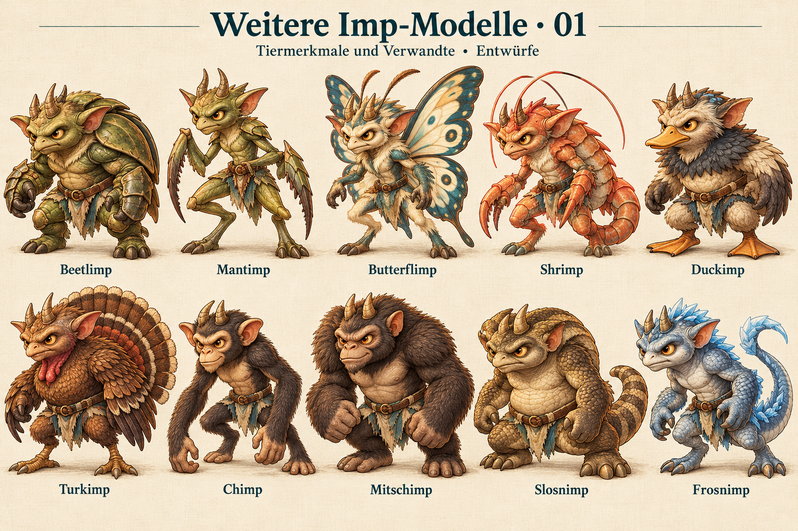
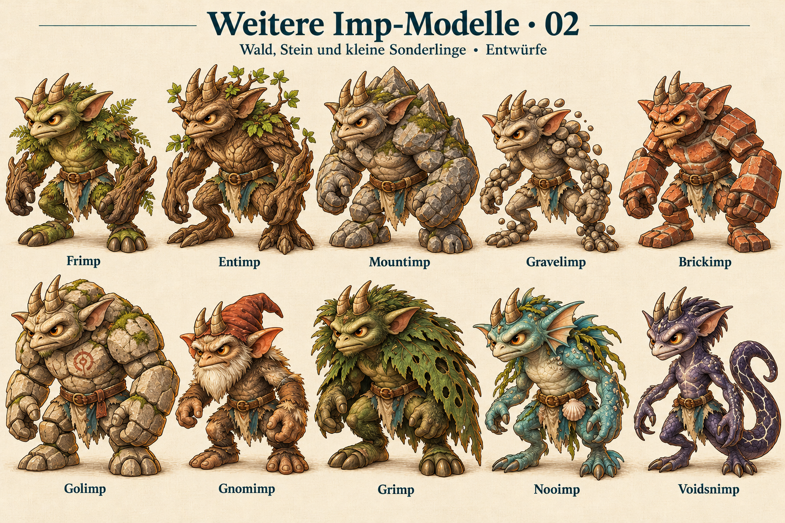
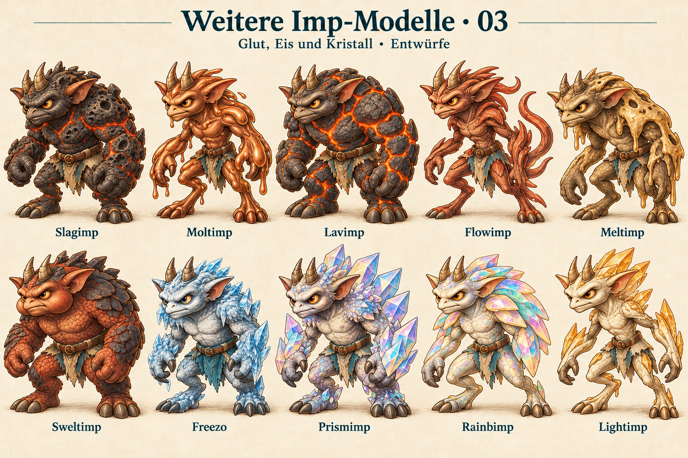
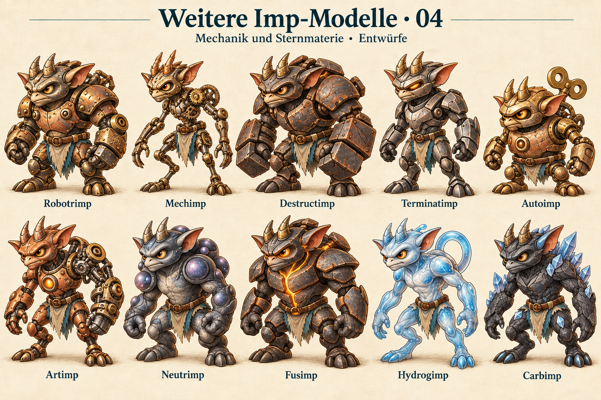
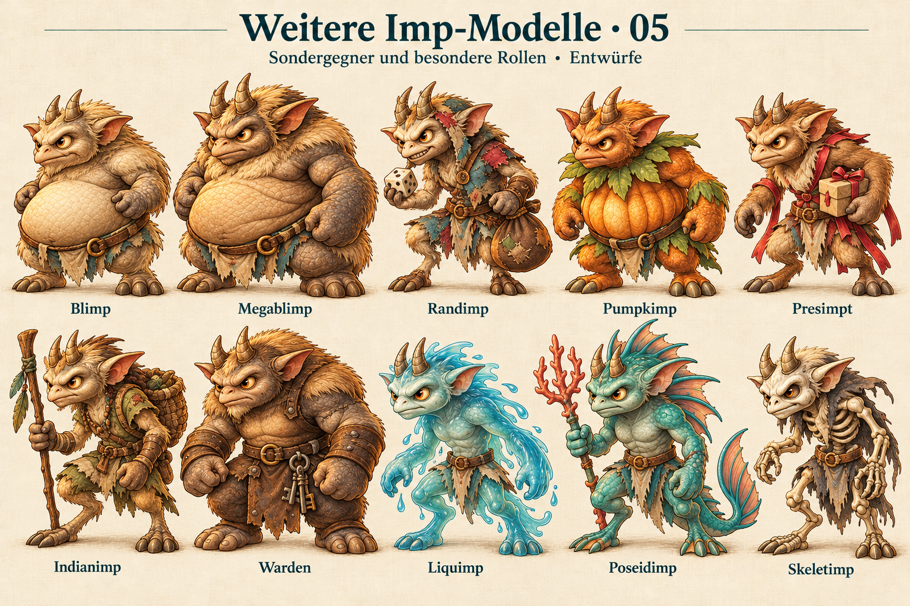
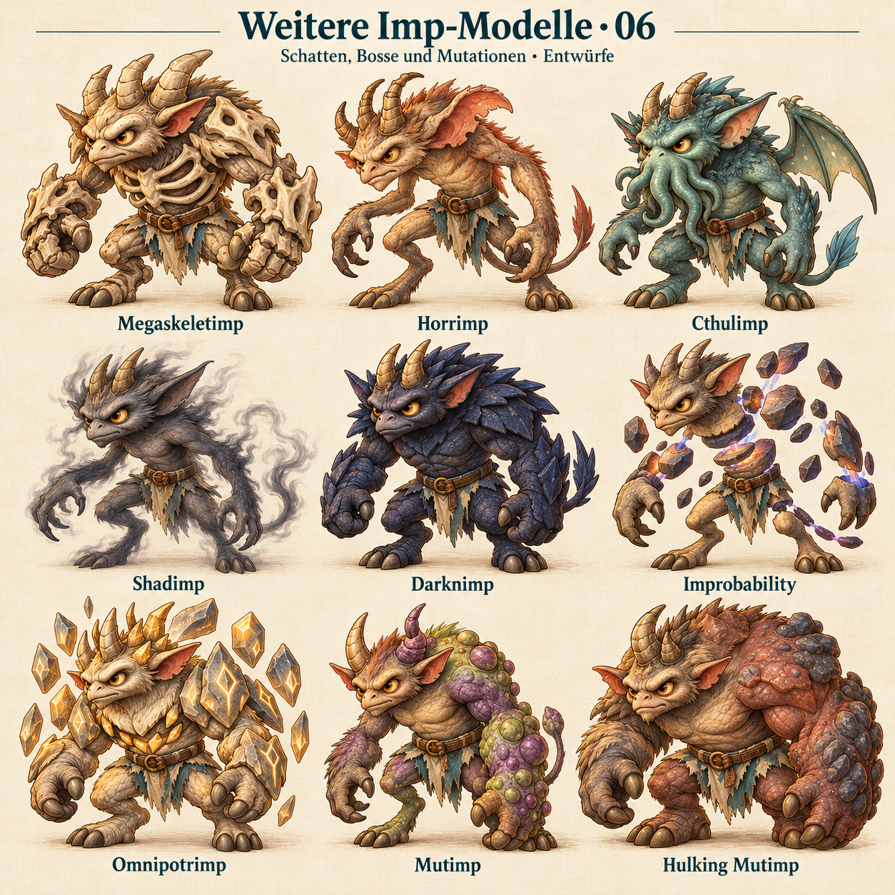

# Gegnermodelle: Bestandsprüfung und Alternativen

Geprüft am 24.10.2026 gegen integration/next, Commit d27e7e7. Die Grafikzuordnung deckt exakt alle 85 Original-badGuys ab: 26 eigene überarbeitete Modelle, 54 Einträge auf älteren Grafiktafeln und 5 Einträge mit gemeinsam verwendeter neuer Grafik. Für die verbleibenden 59 gibt es unten je einen Entwurf.

Die alten Grafiktafeln sind bereits projekteigene Illustrationen. „Noch offen“ bedeutet hier: noch kein eigenes Modell im neueren gemeinsamen Imp-Stil. Die Vorschläge sind freie gestalterische Deutungen, keine Original-Lore und keine Änderungen an Werten, Fähigkeiten, Freischaltungen oder Spielständen. Die Tafeln sind Präsentationsentwürfe; transparente Einzelgrafiken müssten nach Auswahl separat produziert werden.

Turkimp ist bereits in V-132 / #204 erfasst: https://github.com/Imperceptus22/trimps-mobile/issues/204

## 01 – Tiermerkmale und Verwandte

| Gegner | Heute | Alternativvorschlag |
|---|---|---|
| Beetlimp | Ältere Grafiktafel: beetle | Kompakter olivgrüner Imp mit gewölbten Käfer-Flügeldecken am Rücken und kräftigen Panzerarmen. |
| Mantimp | Ältere Grafiktafel: mantis | Schlanker salbeigrüner Imp mit langen, angewinkelten Fangarmen und kleinen Chitinplatten. |
| Butterflimp | Ältere Grafiktafel: butterfly | Leichter Imp mit großen creme-petrolfarbenen Schmetterlingsflügeln und feinen Fühlern zwischen den Hörnern. |
| Shrimp | Ältere Grafiktafel: shrimp | Korallfarbener Imp mit gegliedertem Rückenpanzer, langen Fühlern und eingerolltem Garnelenschwanz. |
| Duckimp | Ältere Grafiktafel: duck | Gedrungener Imp mit kurzem Entenschnabel, dunklem Federkragen und breiten Schwimmfüßen. |
| Turkimp | Ältere Grafiktafel: turkey | Stolzer kupferbrauner Truthahn-Imp mit breitem Schwanzfächer und rotem Kehllappen; klar von Chickimp und Flutimp unterscheidbar. |
| Chimp | Gemeinsames neues Bild: Gorillimp | Schlanker Schimpansen-Imp mit langen Armen, heller Gesichtsmaske und kurzem dunklem Fell; deutlich leichter als Gorillimp. |
| Mitschimp | Gemeinsames neues Bild: Gorillimp | Stämmiger Affen-Imp mit mächtigen Fäusten, dichter Schulterbehaarung und breitem, entschlossenem Gesicht. |
| Slosnimp | Gemeinsames neues Bild: Snimp | Schwerer olivbrauner Schlangen-Imp mit tiefem Stand, breitem Bauch und kurzem, dickem Ringelschwanz. |
| Frosnimp | Gemeinsames neues Bild: Snimp | Blaugrauer Schlangen-Imp mit vereisten Schuppenkanten und einem geschwungenen Schwanz; der Imp-Kopf bleibt sichtbar. |

## 02 – Wald, Stein und kleine Sonderlinge

| Gegner | Heute | Alternativvorschlag |
|---|---|---|
| Frimp | Ältere Grafiktafel: tree | Moosgrüner Wald-Imp mit rindenartigen Unterarmen und kleinen Farnbüscheln an den Schultern. |
| Entimp | Ältere Grafiktafel: tree | Breiter Baum-Imp mit knorrigem Rindenkörper, Wurzelfüßen und wenigen Blättern an den Hörnern. |
| Mountimp | Ältere Grafiktafel: stone | Massiger grauer Fels-Imp mit bergförmiger Schulterlinie, rauer Steinhaut und erdfarbenem Leinentuch. |
| Gravelimp | Ältere Grafiktafel: stone | Kleiner Kies-Imp aus runden Steinsegmenten, mit lockeren Kieseln an Schultern und Knöcheln. |
| Brickimp | Ältere Grafiktafel: stone | Kantiger Imp mit ziegelroten, gemauert wirkenden Körperplatten und breiten rechteckigen Unterarmen. |
| Golimp | Ältere Grafiktafel: stone | Alter Golem-Imp mit großen behauenen Steinplatten, tiefen Fugen und einer einzelnen verwitterten Brustmarkierung. |
| Gnomimp | Ältere Grafiktafel: goblin | Kleiner, bärtiger Imp mit kurzer Stoffkappe zwischen sichtbaren Hörnern und abgetragenem Ledergürtel. |
| Grimp | Ältere Grafiktafel: goblin | Dunkelgrüner Wald-Imp mit grimmigen Brauen, zottigem Nacken und großem, löchrigem Blattumhang. |
| Nooimp | Ältere Grafiktafel: goblin | Türkisgrauer Meeres-Imp mit runden Flossenohren, Algenbüschel und einer Muschel am Gürtel. |
| Voidsnimp | Gemeinsames neues Bild: Snimp | Schlanker dunkelvioletter Schlangen-Imp mit hellen Schuppenrissen und sichelförmig eingerolltem Schwanz. |

## 03 – Glut, Eis und Kristall

| Gegner | Heute | Alternativvorschlag |
|---|---|---|
| Slagimp | Ältere Grafiktafel: lava | Dunkler Schlacken-Imp mit porösem schwarzem Panzer und nur wenigen mattglühenden Fugen. |
| Moltimp | Ältere Grafiktafel: lava | Kupferoranger Imp mit weich fließenden, metallisch wirkenden Körperkanten und schweren Tropfen an den Unterarmen. |
| Lavimp | Ältere Grafiktafel: lava | Breiter Basalt-Imp mit klar erkennbaren orangefarbenen Lavakanälen zwischen großen Gesteinsplatten. |
| Flowimp | Ältere Grafiktafel: lava | Schlanker rostroter Imp mit glatten, wellenförmigen Körperrippen und einer seitlich fließenden Silhouette. |
| Meltimp | Ältere Grafiktafel: lava | Asymmetrischer Imp mit abgesunkenen Schultern und schmelzend wirkenden, stumpf goldenen Körperplatten. |
| Sweltimp | Ältere Grafiktafel: lava | Kräftiger ziegelroter Hitze-Imp mit aufgeblähten Wangen und breiten, dunklen Schuppenplatten. |
| Freezo | Ältere Grafiktafel: ice | Gedrungener Eis-Imp mit rauer Frosthaut, kurzen Eiszapfen an den Brauen und petrolfarbenem Leinentuch. |
| Prismimp | Ältere Grafiktafel: crystal | Imp mit großen, klaren prismatischen Kristallplatten auf Rücken und Unterarmen; Gesicht und Ohren bleiben lesbar. |
| Rainbimp | Ältere Grafiktafel: crystal | Perlmuttfarbener Imp mit wenigen breiten, gedämpft regenbogenfarbenen Kristallfächern an den Schultern. |
| Lightimp | Ältere Grafiktafel: crystal | Schlanker elfenbeinfarbener Imp mit schmalen bernsteinfarbenen Kristallkanten und einer klaren, hellen Silhouette. |

## 04 – Mechanik und Sternmaterie

| Gegner | Heute | Alternativvorschlag |
|---|---|---|
| Robotrimp | Ältere Grafiktafel: robot | Breiter Eisen-Kupfer-Roboter in Imp-Gestalt mit genieteten Hörnern, Ohrenplatten und sichtbaren Gelenken. |
| Mechimp | Ältere Grafiktafel: robot | Drahtiger mechanischer Imp mit kleinen freiliegenden Zahnrädern, dünnen Gliedmaßen und einfacher Leinen-Schürze. |
| Destructimp | Ältere Grafiktafel: robot | Schwerer Maschinen-Imp mit großen Hammerfäusten und abgenutzten dunklen Panzerplatten. |
| Terminatimp | Ältere Grafiktafel: robot | Aufrechter, kompakter Stahl-Imp mit schmalen bernsteinfarbenen Augenschlitzen und glatten, strengen Panzerformen. |
| Autoimp | Ältere Grafiktafel: robot | Kleiner tonnenförmiger Automaten-Imp mit runden Gelenken, aufziehschlüsselartigem Rückenstück und kurzen Armen. |
| Artimp | Ältere Grafiktafel: atom | Kupferfarbener Bionik-Imp mit asymmetrisch ergänztem Mechanikarm und kreisförmiger Brustplatte. |
| Neutrimp | Ältere Grafiktafel: atom | Schiefergrauer Sternmaterie-Imp mit dichtem, rundlichem Körperkern und wenigen matten Kugelknoten an den Schultern. |
| Fusimp | Ältere Grafiktafel: atom | Breiter Imp mit zwei ineinandergreifenden Brustplatten und einer einzelnen warm glühenden Fuge in der Mitte. |
| Hydrogimp | Ältere Grafiktafel: atom | Sehr leichter blassblauer Imp mit abgerundeten, fast durchscheinenden Hautpartien und einem einzelnen ovalen Rückenring. |
| Carbimp | Ältere Grafiktafel: atom | Anthrazitfarbener Imp mit facettierter Kohlenstoffhaut und wenigen klaren diamantartigen Kristallspitzen. |

## 05 – Sondergegner und besondere Rollen

| Gegner | Heute | Alternativvorschlag |
|---|---|---|
| Blimp | Ältere Grafiktafel: blimp | Rundlicher Imp mit ballonartig aufgeblähtem Oberkörper, kleinen Armen und deutlich sichtbaren Füßen; keine Luftschiff-Gondel. |
| Megablimp | Ältere Grafiktafel: blimp | Sehr breiter Ballon-Imp mit tief gefaltetem Bauch, kräftigeren Hörnern und schweren, kurzen Beinen. |
| Randimp (intern Magimp) | Ältere Grafiktafel: wizard | Randimp: verschmitzter Imp mit verschieden geformten Stoffflicken, einem Würfel und einer geschlossenen Überraschungstasche; deutlich ohne Magnimps Magnet. |
| Pumpkimp | Ältere Grafiktafel: pumpkin | Imp mit geripptem kürbisfarbenem Rumpf und kleinem Blattkragen; natürliche Hörner und lebendiges Gesicht statt Kürbislaterne. |
| Presimpt | Ältere Grafiktafel: gift | Warmbrauner Imp mit kurzen, geschenkbandartigen Stoffstreifen und einem kleinen verpackten Päckchen unter dem Arm. |
| Indianimp | Ältere Grafiktafel: ranger | Eigenständiger Wildnis-Imp in schlichter Leinen- und Lederkleidung, mit Wanderstock und geflochtener Tasche. |
| Warden | Ältere Grafiktafel: warden | Breitschultriger Wächter-Imp mit abgetragenem Lederschurz, kleinem Schlüsselbund und massiven Unterarmen. |
| Liquimp | Ältere Grafiktafel: water | Aquamarinfarbener Imp mit weichen, wasserartig fließenden Körperrändern und kleinen Tropfen am Unterarm. |
| Poseidimp | Ältere Grafiktafel: water | Kräftiger meergrüner Imp mit Flossenkamm, kurzem Korallen-Dreizack und breit gefächertem Schwanz. |
| Skeletimp | Ältere Grafiktafel: skeleton | Schlanker knochenfarbener Imp mit sichtbarem stilisiertem Rippenkorb, gehörntem Schädel und zerrissenem Leinentuch; ohne Blut. |

## 06 – Schatten, Bosse und Mutationen

| Gegner | Heute | Alternativvorschlag |
|---|---|---|
| Megaskeletimp | Ältere Grafiktafel: skeleton | Massiger Skelett-Imp mit breitem Rippenkorb, großen Knochenfäusten und dicken Hörnern; ohne Blut. |
| Horrimp | Ältere Grafiktafel: eldritch | Unruhig gekrümmter, asymmetrischer Imp mit langem Rücken, ungleichen Ohren und angespannten Brauen. |
| Cthulimp | Ältere Grafiktafel: eldritch | Tief meergrüner Imp mit kurzem Tentakelbart, kleinen gefalteten Membranflügeln und klar sichtbaren Armen und Beinen. |
| Shadimp | Ältere Grafiktafel: eldritch | Schmaler rauchgrauer Imp mit weich aufgelösten Körperrändern, spitzen Ohren und sichtbaren bernsteinfarbenen Augen. |
| Darknimp | Ältere Grafiktafel: eldritch | Breiter nachtblauer Imp mit matten, gefalteten Schattenplatten und deutlicher Kontur; vollständig gezeichnet statt schwarzem Fleck. |
| Improbability | Ältere Grafiktafel: eldritch | Imp mit wenigen bewusst unmöglich gegeneinander versetzten Körpersegmenten und schwebenden Steinfragmenten; Kopf und Gliedmaßen bleiben eindeutig. |
| Omnipotrimp | Ältere Grafiktafel: eldritch | Großer, ruhiger Boss-Imp mit breiten Schultern, kronenartig angeordneten Hornspitzen und wenigen schwebenden Kristallplatten. |
| Mutimp | Ältere Grafiktafel: mutant | Gedrungener violettgrüner Imp mit einem vergrößerten Arm, ungleichen Hörnern und einzelnen knolligen Hautplatten. |
| Hulking Mutimp | Ältere Grafiktafel: mutant | Sehr massiger Mutanten-Imp mit gewaltigem asymmetrischem Oberkörper, großem Einzelarm und kräftigen, standfesten Beinen. |

## Bereits eigenständig überarbeitet (26)

Arachnimp, Chickimp, Chronoimp, Dragimp, Elephimp, Feyimp, Flutimp, Goblimp, Gorillimp, Hippopotamimp, Jestimp, Kangarimp, Kittimp, Magnimp, Onoudidimp, Penguimp, Platypimp, Seirimp, Snimp, Squimp, Squirrimp, Tauntimp, Titimp, Turtlimp, Venimp, Whipimp

## Grenzen

Nur Bestandsprüfung und Entwürfe. Keine App-Änderung und kein APK-Build. Noch keine Prüfung der neuen Motive in tatsächlicher Handy-Darstellungsgröße.

Quellen: MobileEnemyArt und Original-badGuys sowie docs/design/imp-family und docs/design/imp-graphics-2026-10-23 am oben genannten Commit. Bildherkunft und unveränderte Originalausgaben siehe provenance.json.